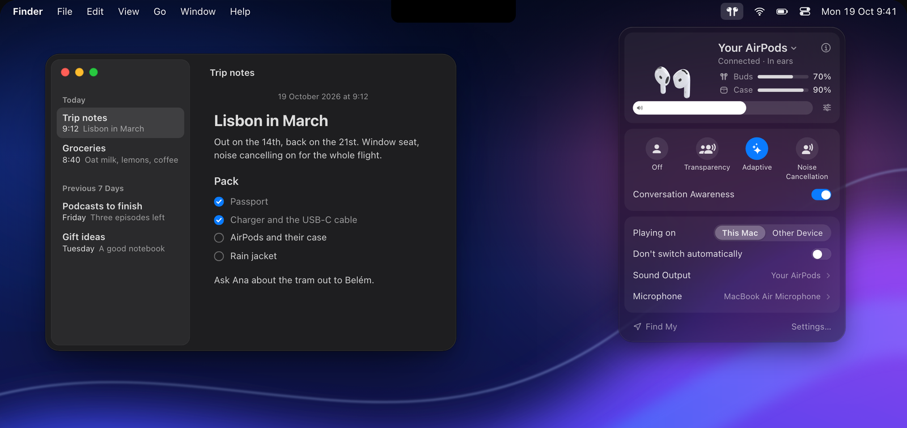
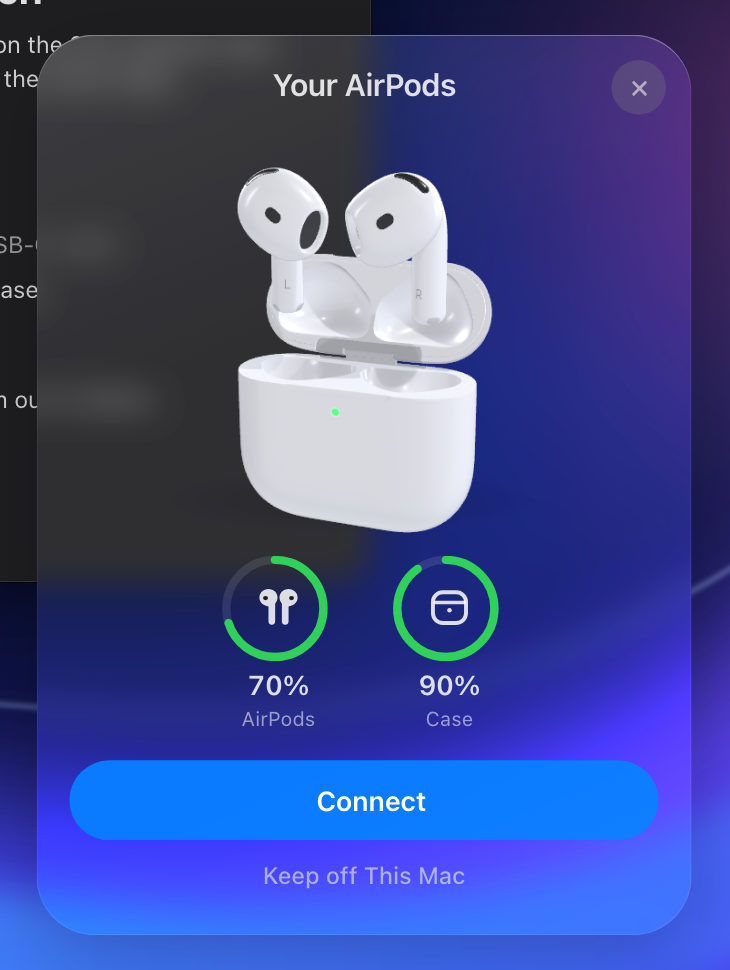
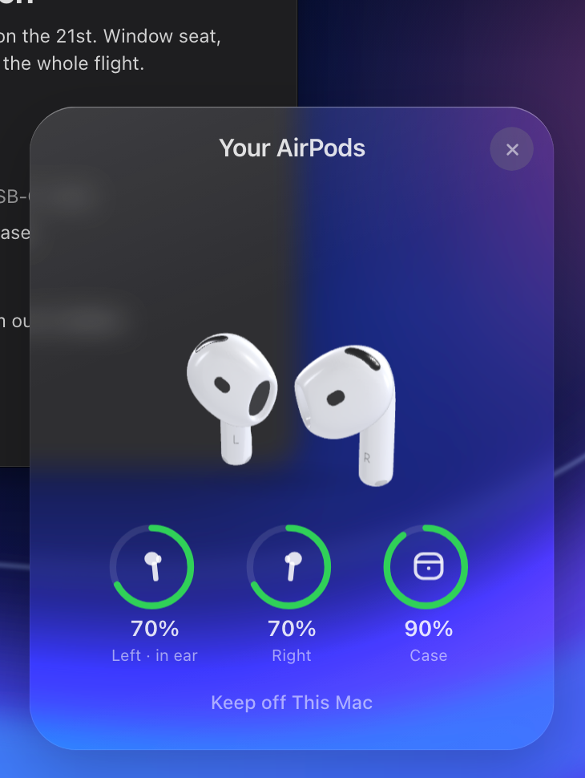
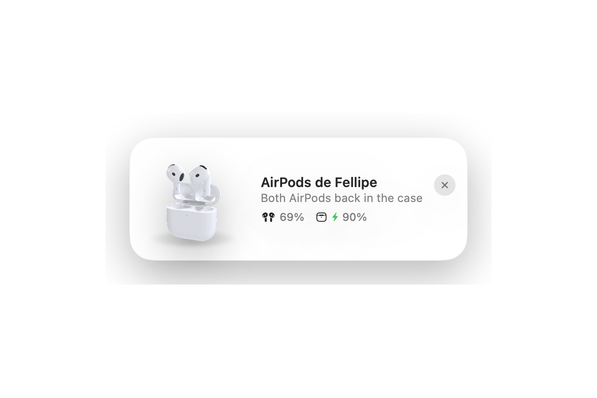
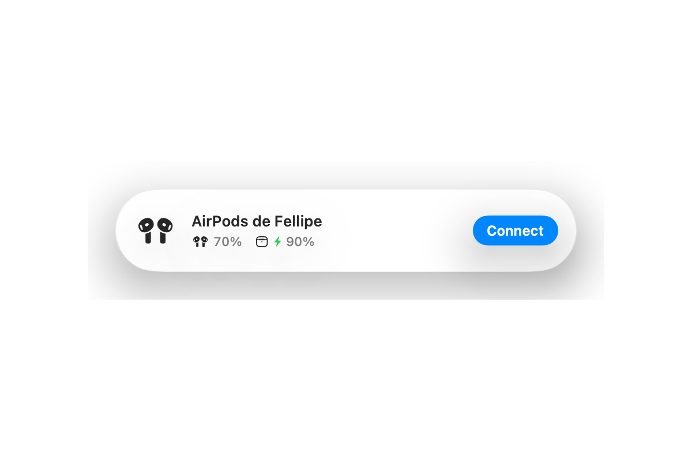

  

<h1 align="center">AirPane</h1>

  <strong>Your AirPods, at home on your Mac.</strong> 
  A menu bar app for AirPods. Free for 7 days, then $7.99 once, for all your own Macs.

  
  
  
  

  

  
  &nbsp;
   
  One-time purchase, never a subscription. Full refund within 30 days. <a href="https://airpane.app">airpane.app</a>

## What it does

- **Opens when you open the case.** Batteries and a Connect button the moment the lid opens, or when AirPods Max
  leave their Smart Case.
- **Everything in one click.** Battery, volume up to 200%, what's playing, noise control, Conversation Awareness,
  Spatial Audio, and where the sound goes, all in the menu bar.
- **Keeps them where you want them.** Choose the Mac or your other device, keep your microphone, stop automatic
  switching.

<table>
  <tr>
    <td width="50%">
       
      <b>Just open the case.</b> Batteries and a Connect button, the moment the lid opens.
    </td>
    <td width="50%">
      
       
      <b>Each bud on its own.</b> Left, right and the case, once they're out.
    </td>
  </tr>
  <tr>
    <td>
      <picture>
        <source media="(prefers-color-scheme: dark)" srcset="images/small-dark.png">
        
      </picture> 
      <b>The small things.</b> A quiet card when you put them back in the case.
    </td>
    <td>
      <picture>
        <source media="(prefers-color-scheme: dark)" srcset="images/pill-dark.png">
        
      </picture> 
      <b>Your size.</b> A full card, a compact one, a slim one, or one that drops from the notch.
    </td>
  </tr>
</table>

<b>Everything else</b>

 

A sleep timer, a volume limit for your ears, when the case will be full, a battery widget, low battery alerts, hot
keys, Shortcuts and AppleScript, and Liquid Glass, frosted, tinted or solid to match your Mac.

<b>Nothing leaves your Mac</b>

 

No account, no analytics, no ads and no crash reporter. Its only connection is an update check you can switch off,
and nothing about you is sent. [Read the privacy note](https://airpane.app/privacy).

<b>Buying, and your licence key</b>

 

AirPane is free for 7 days, then a one-time purchase of **$7.99**, never a subscription, and it works on all your own
Macs. If it isn't right for you, you get a full refund within 30 days. [Buy it at airpane.app](https://airpane.app/#buy):
your licence key appears on the page right after you pay, and it activates offline. Lost it?
[Recover your key](https://airpane.app/recover).

<b>Requirements, and opening it the first time</b>

 

A Mac with macOS 14 or later and a pair of AirPods (volume above 100% needs macOS 14.2).

AirPane isn't notarized by Apple yet, so macOS asks you to confirm it the first time you open it.
[Here's how](https://airpane.app/open). The notarized version will come as a normal update.

## This repository

AirPane is closed source. This repository holds its release downloads, which the app also updates from, and the
place to [report a problem](https://github.com/fellipegoncalvesleite/airpane-releases/issues/new/choose).

---

Not affiliated with Apple. AirPods and Mac are trademarks of Apple Inc.
