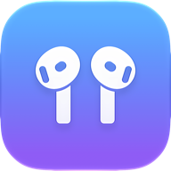
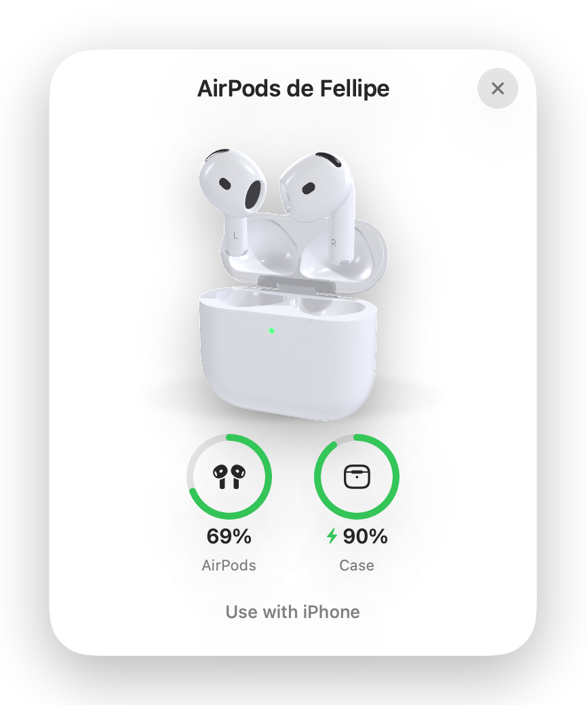
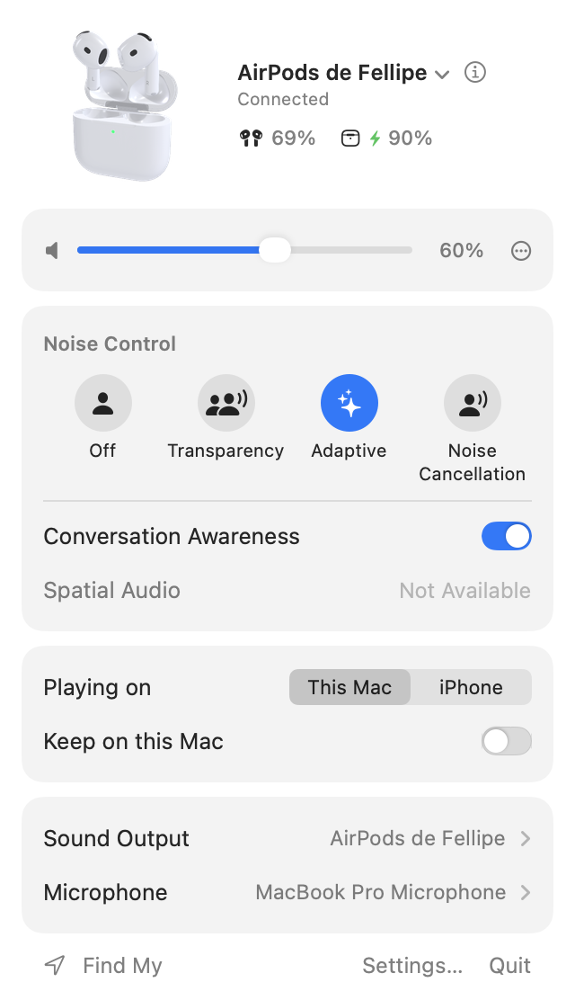

  

<h1 align="center">AirPane</h1>

  <strong>Your AirPods, at home on your Mac.</strong> 
  A menu bar app for AirPods. $7.99 once, for all your own Macs.

  <a href="https://airpane.app"><strong>airpane.app</strong></a>
  &nbsp;·&nbsp;
  <a href="https://airpane.app/#buy">Buy AirPane</a>
  &nbsp;·&nbsp;
  <a href="https://github.com/fellipegoncalvesleite/airpane-releases/releases/latest/download/AirPane.dmg">Download</a>

  <picture>
    <source media="(prefers-color-scheme: dark)" srcset="images/card-dark.png">
    
  </picture>
  <picture>
    <source media="(prefers-color-scheme: dark)" srcset="images/panel-dark.png">
    
  </picture>

## What it does

- **Opens when you open the case.** Batteries and a Connect button the moment the lid opens, or when AirPods Max
  leave their Smart Case.
- **Noise control in the menu bar.** Off, Transparency, Adaptive and Noise Cancellation, one click away.
- **Volume up to 200%.** For the quiet call and the quieter video.

And the small things: a sleep timer, a volume limit for your ears, when the case will be full, a battery widget, a
small card when you put one AirPod back, sound output and microphone right from the panel, low battery alerts, hot
keys, Shortcuts and AppleScript, and Liquid Glass, frosted, tinted or solid to match your Mac.

## Nothing leaves your Mac

No account, no analytics, no ads and no crash reporter. Its only connection is an update check you can switch off,
and nothing about you is sent. [Read the privacy note](https://airpane.app/privacy).

## Getting it

AirPane is a one-time purchase of **$7.99**, never a subscription, and it works on all your own Macs. If it isn't
right for you, you get a full refund within 30 days. [Buy it at airpane.app](https://airpane.app/#buy): your licence
key appears on the page right after you pay, and it activates offline. Lost it?
[Recover your key](https://airpane.app/recover).

You need a Mac with macOS 14 or later and a pair of AirPods (volume above 100% needs macOS 14.2).

AirPane isn't notarized by Apple yet, so macOS asks you to confirm it the first time you open it.
[Here's how](https://airpane.app/open). The notarized version will come as a normal update.

## This repository

AirPane is closed source. This repository holds its release downloads, which the app also updates from, and the
place to [report a problem](https://github.com/fellipegoncalvesleite/airpane-releases/issues/new/choose).

---

Not affiliated with Apple. AirPods and Mac are trademarks of Apple Inc.
